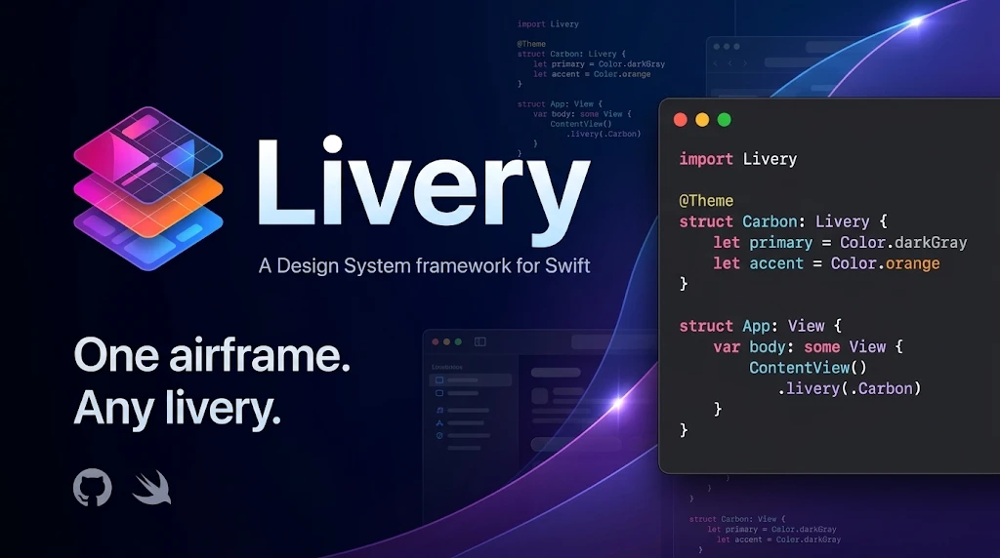

<p align="center">
  
</p>

# Livery

**One airframe. Any livery.**

Livery es un framework para construir sistemas de diseño en Swift. No trae un look;
trae la estructura que Apple nunca dio: capas, reglas y migraciones, verificadas por
el compilador.

Una aerolínea pinta aviones idénticos con libreas distintas. Aquí la estructura es el
fuselaje y tu marca es la librea: los roles no cambian, cambia cómo se resuelven.
Cambiar de marca, de modo o de sistema de diseño entero es repintar, no reconstruir.

## Empezar

La estructura no se documenta: se genera. `theme init` crea un paquete Swift con los
primitivos en un módulo aparte, los roles y temas con el plugin activo, y un test.

```bash
swift run --package-path Livery theme init DesignSystem
```

Produce `DesignSystem/` con `DesignSystemPrimitives` (la paleta, que solo el otro módulo
importa) y `DesignSystem` (roles y temas), listo para enlazar en la app y aplicar con
`.environment(\\.theme, .base)`. Con `--livery <ruta>` toma Livery de una copia local.

## Cómo se ve

```swift
import Livery

// Qué existe. Los nombres los pone tu proyecto; las categorías las fija Livery.
@Roles enum Colors: ColorRoles  { case surface, onSurface, accent }
@Roles enum Spacing: SpaceRoles { case sm, md, lg }

// Cómo se resuelve. Si falta un rol, el compilador lo señala en esta línea.
// Un color es un Shade: claro y oscuro decididos, contraste aumentado opcional.
@Theme struct Carbon: Colors.Resolver, Spacing.Resolver {
    let surface   = Shade(light: .white, dark: .black)
    let onSurface = Shade(light: .black, dark: .white, darkIncreased: .white)
    let accent    = Shade(.orange)
    let sm: CGFloat = 8, md: CGFloat = 16, lg: CGFloat = 24
}

// Las vistas leen el tema del entorno y hablan solo en roles: sin primitivos, sin strings.
// `theme` tiene su tipo declarado aquí, así que cada paso autocompleta con los roles que existen.
struct Card: View {
    @Environment(\.theme) private var theme

    var body: some View {
        Text("Hola")
            .font(theme.type.body)
            .foregroundStyle(theme.color.onSurface)
            .padding(theme.space.lg)
            .background(theme.color.surface, in: .rect(cornerRadius: theme.shape.medium))
    }
}

// Una vez, en la raíz. Es el entorno de SwiftUI, no un mecanismo propio.
ContentView().environment(\.theme, .carbon)
```

Con `import Livery` basta: Livery reexporta SwiftUI.

`theme.color` y `.carbon` no los escribe un macro, porque un macro no puede extender `Theme`
desde otro tipo. Los escribe el generador de Livery, el `aapt` del framework, de dos formas:

- `swift package --allow-writing-to-package-directory livery-generate` (o LiveryGenerate desde
  Xcode, con clic derecho en el paquete) deja `Sources/<Target>/Generated/Livery+Registry.swift`.
  Al vivir en Sources, Xcode lo trata como código normal: navegación y autocompletado sin depender
  del índice de salidas de plugins. `theme init` ya lo deja escrito.
- El build-tool plugin `LiveryRegistry` corre en cada build: si el archivo existe, comprueba que
  esté al día y falla si no; si no existe, lo genera en el directorio de build. En ambos casos
  verifica los puentes, emite el reporte de migración y hace el lint.

Actívalo en el target que declara el sistema de diseño:
recorre los fuentes del target antes de compilar y escribe la extensión de `Theme` que un macro
no puede escribir. Actívalo en el target que declara el sistema de diseño:

```swift
.target(
    name: "App",
    dependencies: [.product(name: "Livery", package: "Livery")],
    plugins: [.plugin(name: "LiveryRegistry", package: "Livery")]
)
```

Un tema con parámetros no recibe acceso corto; se aplica con `.environment(\\.theme, adding: Brand(accent: .red))`.

## Verlo funcionar

`Examples/Showcase` es un sistema de diseño completo declarado con Livery, con la estructura que
el framework propone: `Primitives` en un módulo que solo `DesignSystem` importa, y una app que
no puede leer `Palette` ni queriendo. Cambia de tema, de modo y de densidad en vivo.

```bash
swift run --package-path Examples/Showcase
```

## Qué verifica el compilador

- **Tema incompleto.** Un tema que olvida un rol es un error de conformance en la línea del tema, con fix-it.
- **Modo olvidado.** Un rol de color es un `Shade`, no un `Color`: claro y oscuro se deciden siempre, y el contraste aumentado es opcional. Se resuelve al dibujar según el entorno, también para UIKit y AppKit.
- **Movimiento sin respeto a accesibilidad.** Un rol de movimiento es un `Motion` con su variante para "Reducir movimiento"; sin ella, la animación se omite cuando el ajuste está activo.
- **Sombra plana en oscuro.** Un rol de elevación es un `Elevation` cuyo color es un `Shade`: la sombra se decide para claro y oscuro, porque un negro al 10% casi no se ve sobre un fondo oscuro. Se aplica con `.elevation(theme.elevation.card)`.
- **Tipografía que no escala.** Un rol de tipografía es un `TypeStyle`, no un `Font`: se construye relativo a un estilo de texto del sistema, así escala con Dynamic Type por construcción; un tamaño fijo en puntos no compila.
- **Vistas sin primitivos.** La paleta vive en un módulo que las vistas no importan. Leer `Palette.jade500` desde una vista no compila.
- **Roles mal declarados.** Un enum sin categoría, una categoría repetida o un caso con valores asociados son diagnósticos del macro.
- **Subárbol sin tema.** En debug, una advertencia de runtime y colores rosa; nunca un fallo en silencio.
- **Contraste insuficiente.** `theme.contrastReport()` lista los pares `onX`/`X` que no llegan al contraste WCAG AA, en claro y oscuro. Puesto en un test, CI verifica la accesibilidad en cada push.
- **Valores sueltos en vistas.** Con el plugin activo en un target de UI, un `Color(red:…)`, un `.foregroundStyle(.blue)`, un `.font(.system(size: 14))` o un `.padding(12)` es un warning con archivo y línea. Los módulos que declaran roles, temas o primitivos quedan exentos.

## Componentes

Un componente es un contrato, y su estilo una tabla en roles que vive en el tema. El botón del
ejemplo sigue las Human Interface Guidelines de Apple: un tinte y los tres estilos del sistema,
con lo destructivo como rol.

```swift
Button("Analizar") { … }.buttonStyle(.themed(.prominent))               // como .borderedProminent
Button("Guardar")  { … }.buttonStyle(.themed(.bordered))                // como .bordered
Button("Detalles") { … }.buttonStyle(.themed(.plain))                   // como .plain
Button("Borrar", role: .destructive) { … }.buttonStyle(.themed(.bordered))   // el rol lo pinta de rojo
```

Es un `ButtonStyle` de SwiftUI de verdad: hereda teclado, VoiceOver y `Button(role:)`, toma el
tamaño de `.controlSize`, es una cápsula como en iOS, y garantiza 44 pt de área táctil. Cambiar
de tema cambia el tinte sin tocar el estilo. El kernel deja modelar cualquier componente; el
ejemplo enseña las convenciones de Apple. `@Component` sobre el enum genera el protocolo que el
tema conforma, y el plugin genera `theme.button`; el autor solo escribe el estilo. El ejemplo
trae también un campo de texto (`FormField`) con estados de foco y error, para mostrar que el
modelo sirve más allá de un botón.

## Primitivos nativos

Para lo que SwiftUI ya da —`Text`, `Button`, `Toggle`, iconos SF Symbols— el sistema no inventa
componentes: aplica los roles del tema y los estilos nativos. El acento se pone una vez con `.tint`
y los controles del sistema lo siguen.

Un estilo de texto junta fuente y color en una sola llamada, para no repetir `.font` y
`.foregroundStyle` en cada `Text`. Vale para `Text`, `Label` y la etiqueta de un `Toggle`.

```swift
Text("Título").textStyle(.title)
Label("Reproducir", systemImage: "play.circle.fill").textStyle(.accent)
Toggle("Notificaciones", isOn: $on).textStyle(.body)   // y sigue el .tint del tema
ContentView().tint(theme.color.accent)                 // el acento, una vez, en la raíz
```

Se construye un componente propio (como el campo de texto de arriba) solo cuando SwiftUI no
ofrece el control; para todo lo demás, tokens y estilos nativos.

## Sincronizar con diseño (W3C Design Tokens)

Swift es la fuente; Penpot y Figma son destino. El tema se exporta a W3C Design Tokens, que abren
Penpot y Figma (Tokens Studio).

**Exportar** necesita los valores resueltos, así que es una API de runtime que el plugin genera:

```swift
let json = Theme.daylight.w3cTokens(mode: .light)   // String W3C, listo para escribir a un archivo
```

Produce colores (hex por modo), espaciado y radios (`dimension`) y tipografía (compuesta). Un
archivo es de un modo; exporta claro y oscuro por separado.

**Importar** convierte un archivo de tokens del diseñador en primitivos Swift, como andamio:

```bash
swift run --package-path Livery theme import marca.tokens.json --name Marca --out Marca.swift
```

Escribe `@Primitives` con los colores y medidas; luego los nombras como roles. El ciclo cierra:
lo que exportas se vuelve a importar con los mismos valores.

## Migrar de un sistema a otro

Cuando llega DS2 con más tokens, menos tokens y renombres, no se tocan vistas: se escribe un
puente, una vez, y el compilador guía el resto.

```swift
@Roles enum ColorsV1: ColorRoles { case primary, cardBackground, divider }   // el viejo
@Roles enum Colors: ColorRoles { case brand, action, surfaceElevated, outline } // el nuevo

@Bridge(from: ColorsV1.self, to: Colors.self)
enum ColorsV1toV2 {
    static let primary        = Colors.brand              // renombrado: fix-it automático
    static let cardBackground = Colors.surfaceElevated
    /// DS2 eliminó el divisor; usa `outline` con opacidad.
    static func divider(_ colors: Colors.Values) -> Shade { colors.outline.opacity(0.4) }
}
```

Con eso, el plugin:

- **Verifica que el puente cubra todos los roles viejos** que no existan en el nuevo. Si falta uno, el build falla en la línea del puente.
- **Genera reenvíos deprecados** en `Colors.Values`. Una vista que lee `theme.color.primary` sigue compilando, recibe `brand`, y muestra un warning con fix-it. Se cambia el tema de la raíz el día uno y toda la app se ve con DS2.
- **Reporta el progreso** en la línea del puente: `Migración ColorsV1 → Colors: 23 usos pendientes en 9 archivos (primary: 12, divider: 11)`. Los warnings son la barra de progreso. En cero, se borra `ColorsV1` y el puente, y lo que quedara pasa de warning a error.

## Estado

Fases 0.1 y 0.2: `@Roles`, `@Theme`, `@Primitives`, `@Bridge`, `Shade`, el plugin `LiveryRegistry`
(registro, puentes, reporte y lint), la CLI `theme init`, `.environment(\.theme, …)`, `.environment(\.theme, adding:)` y
sobrecargas de modificadores para fuente, espaciado y radio.
Swift 6.2, iOS 17 / macOS 14.

El diseño completo, las fases y los riesgos están en [PLAN.md](PLAN.md).
